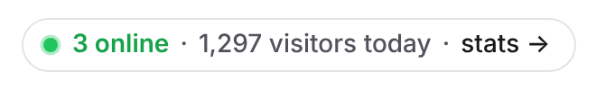

# Live badge

Show how many people are on your site right now and today, in a small badge that links to your
[public dashboard](team-and-sharing.md#public-dashboards):



It's popular on "build in public" sites: visitors can click through to the real numbers.

## Add it to your site

1. Turn on the public dashboard: **Settings → General → Public dashboard → Create public link**.
2. Under **Live badge**, pick a theme and copy the snippet. It looks like this:

   ```html
   <script async src="https://analytics.example.com/js/badge.js"></script>
   <openrev-badge share="YOUR_SHARE_TOKEN"></openrev-badge>
   ```

3. Paste it where the badge should appear, such as next to your logo. The `<script>` can go anywhere on the page,
   once, even with several badges.

The badge appears once its numbers have loaded, refreshes every minute, and stays hidden if they can't be loaded
(for example after you turn the public link off). It opens the public dashboard in a new tab, showing today.

### Options

| Attribute | Values | Default |
| --- | --- | --- |
| `share` | Your public dashboard's token (the part after `/share/`) | required |
| `theme` | `light`, `dark`, or `auto` to follow the visitor's light or dark system setting | `light` |
| `host` | Your OpenRev URL, only needed when `badge.js` is served from somewhere else, such as a [proxy](../tracking/proxy.md) | the script's own origin |

The badge's styles live inside its own shadow root, so your CSS won't change it. To adjust it anyway, style its
`::part(badge)`:

```css
openrev-badge::part(badge) {
  font-size: 13px;
}
```

### Content Security Policy

If your site sends a CSP header, allow your OpenRev instance in `script-src` and `connect-src`. The badge needs no
`style-src` exception: it uses constructable stylesheets, which CSP doesn't restrict.

## As an image

Where scripts can't run, such as a GitHub README, use the SVG version. It shows the same two numbers, without the
"stats →" link text, and Markdown makes the whole image a link:

```md
[](https://analytics.example.com/share/YOUR_SHARE_TOKEN?period=today)
```

Add `?theme=dark` to the image URL for the dark version. Image caches (GitHub's included) can keep a copy for a few
minutes, so it updates less often than the script version.

## What it shows

- **Online:** visitors seen in the last 5 minutes, the same count as the dashboard's realtime view.
- **Visitors today:** unique visitors since midnight in the site's time zone, as on the dashboard with **Today**
  selected.

Both numbers are already on your public dashboard, and the badge only works while that dashboard is shared. Its data
comes from `GET /api/badge/<token>`, which returns `{ "online": 3, "today": 1297 }`. It's cached for 30 seconds and
can be read from any site.
